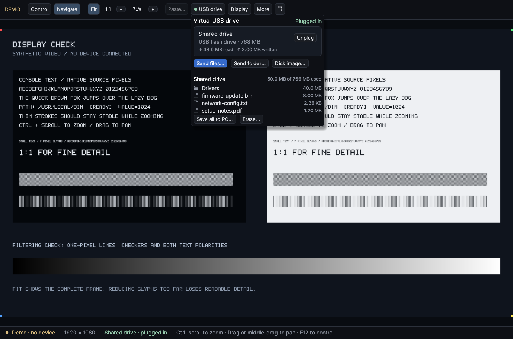

# Better StarTech KVM Viewer

A fast, modern Windows viewer for the StarTech USB Crash Cart Adapter. See and control a headless machine from your laptop, and hand it files on a virtual USB drive.



## Features

- Crisp video at the target's full resolution, with Fit, true 1:1 and smooth Ctrl+scroll zoom
- Keyboard and mouse control that starts when your pointer is over the video. **F12** switches to Navigate
- Virtual USB drive: drop files on the window and the target sees a USB flash drive. Plug in `.img` and `.vhd` images, or an `.iso` as a CD-ROM
- Picture position remembered for each video mode, so no edge is cut off
- Middle-drag to pan, Ctrl+Alt+Del and other special keys, and a button to wake a sleeping display
- Paste text as typed keystrokes, with a preview before anything is sent

## Install

1. Download **USB-Crash-Cart-Setup-0.3.0.exe** from [Releases](https://github.com/JustSuperHuman/Better-Startech-KVM-Viewer/releases).
2. Run it and approve the administrator prompt. Setup installs the viewer, the adapter's signed driver, and the runtime it needs.
3. If the adapter was already plugged in, unplug it and plug it back in.

The original StarTech software isn't needed. Remove the viewer from **Settings → Apps**. The driver stays installed.

## Use

Open **USB Crash Cart** from the Start menu and choose **Connect**.

- **Control the target:** move the pointer over the video. Press **F12** to keep input on your PC.
- **Give the target files:** choose **USB drive → Send files…**, or drop files on the window.
- **Get files back:** unplug the drive, then choose **Save all to PC…**.
- **Fix a cut-off edge:** go to **Display → Picture position**.

Paste is experimental. Try a short sample before you paste commands.

Works with the adapter that reports USB ID `152A:8463`. It was tested with a 1920 × 1080 target.

## Build from source

You need Rust (MSVC) with the 32-bit target, plus the StarTech software installed. The helper loads its runtime.

```powershell
rustup target add i686-pc-windows-msvc
.\scripts\build.ps1 -Test
```

More detail: [guide](docs/guide.md) · [compatibility notes](docs/compatibility.md) · [feature coverage](docs/feature-coverage.md) · [verification](docs/verification.md)

## Third-party components

The installer bundles StarTech.com's USB Crash Cart Adapter driver and runtime components, which stay under StarTech's license (shown during setup). It also bundles Microsoft's Visual C++ 2008 runtime, under Microsoft's terms. The Inter font is under the SIL Open Font License. Other dependency licenses are listed in the package notices.
